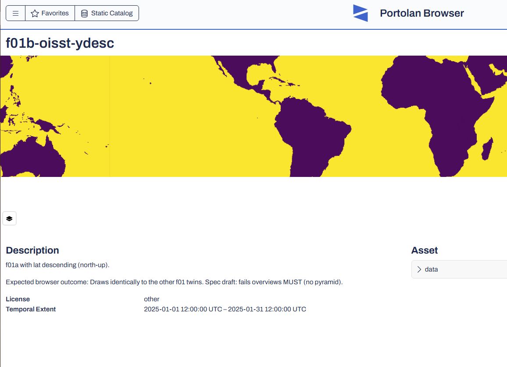

# First results, 2026-11-06

Published F01 (f01a to f01d at the time), copied four index-only virtual
stores, and opened one fixture in portolan-browser (PR 92 branch). Partial:
only f01b has been inspected in the browser so far, and f01e and f01f were
added after this run.

## Transport

`setonix/04-verify.sh`: a GET with an `Origin` header and `Range: bytes=0-99`
against each URL.

| Target | Status | `Access-Control-Allow-Origin` | Exposed headers |
| ------ | ------ | ----------------------------- | --------------- |
| Pawsey: catalog, store and array `zarr.json`, chunks, pyramid level 2 chunk | 206 | `*` | Content-Range, Content-Length, Accept-Ranges, ETag |
| Pawsey: copied virtual indexes (mdim.vrt, Icechunk `repo`, kerchunk `.zmetadata`) | 206 | `*` | same |
| source.coop (original location of the indexes) | 206 | `*` | `*` |
| www.ncei.noaa.gov (bytes behind the OISST virtual references) | 206 | `*` | none |
| noaadata.apps.nsidc.org (bytes behind the G02202 sea ice references) | 206 | **none** | none |

Findings:

- Everything published here is range-readable from a browser.
- The OISST virtual references can be followed from a browser. A client that
  reads `Content-Range` will not see it, because NCEI exposes no headers.
- The G02202 sea ice virtual references cannot be followed from any browser,
  wherever the index is hosted. The index is valid; the host serving the bytes
  sends no CORS header. This is a second real case for the draft's
  requirement that every host serving referenced bytes return
  `Access-Control-Allow-Origin`, and it is why the polar sea ice twins (F03)
  must be physical copies.
- The G02202 index also has no `crs` grid mapping variable, so a CRS check
  refuses it before CORS would matter.

## First draw: f01b-oisst-ydesc

- **Geometry: correct.** North up, continents in place, 0..360 longitude
  shown on a Pacific-centred view. Chunks streamed from the bucket.
- **Ocean colour: saturated.** All ocean is the top colour of the ramp, where
  SST over this view spans roughly 5 to 30 degC. This is consistent with the
  raw packed int16 values (for example 2500 for 25 degC) being drawn against
  a display range given in physical units (-2 to 35), that is, CF
  `scale_factor` in the array attributes not applied.
- **Land: drawn as the bottom colour, not transparent.** The fill value -999
  is treated as a value below the range rather than as empty. The STAC asset
  declared no `nodata` at the time, so this is partly a fixture metadata gap.
- A faint vertical line near the western edge may be a chunk seam (inner
  chunks are 360 columns, 90 degrees). Unconfirmed.

Twins added to separate these causes:

- **f01e** (unpacked float32): if it draws with a proper gradient, CF packing
  is the cause of the saturation.
- **f01f** (`bands[].nodata = -999`): if land is transparent here and not in
  f01b, nodata is only taken from STAC, not from CF `_FillValue` or the Zarr
  `fill_value` (both -999 in these stores).
- **f01d** already contains the comparison within one store: level 0 is
  packed, levels 1 and 2 are unpacked. Zoomed out it should show a gradient
  if packing is the cause.

## Spec questions this raises

1. Is the display range (`bands[].statistics`) in packed or physical units?
   The draft does not say. Physical units seem the only workable answer, which
   then requires clients to apply CF packing (or a `scale_offset` codec)
   before the ramp.
2. Which fill value wins: STAC `bands[].nodata`, CF `_FillValue`, or the Zarr
   `fill_value`? These can differ. Writers differ too: xarray's default for
   Zarr v3 writes `fill_value` 0 beside a CF `_FillValue` of -999 unless told
   otherwise (these fixtures set both to -999).

## Still to inspect

f01a (south-up), f01c (-180..180), f01d (pyramid, zoomed out), f01e, f01f,
and the copied virtual stores once they have catalog entries.
